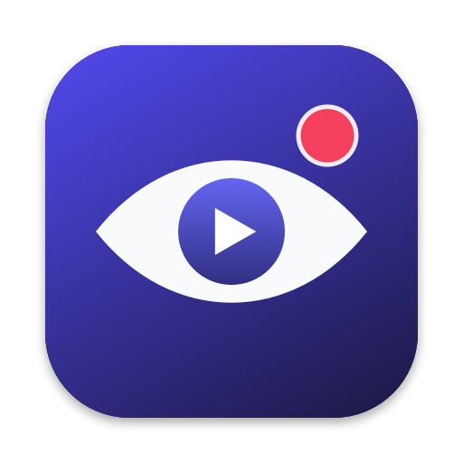
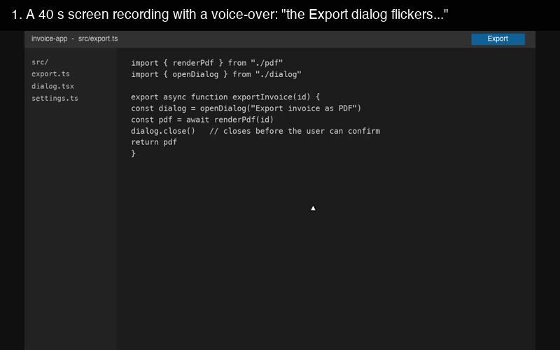
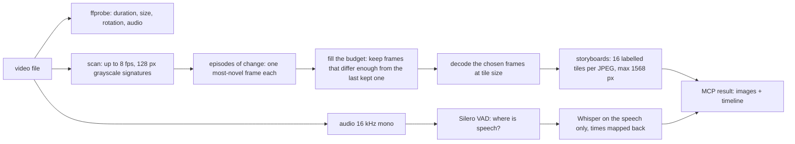
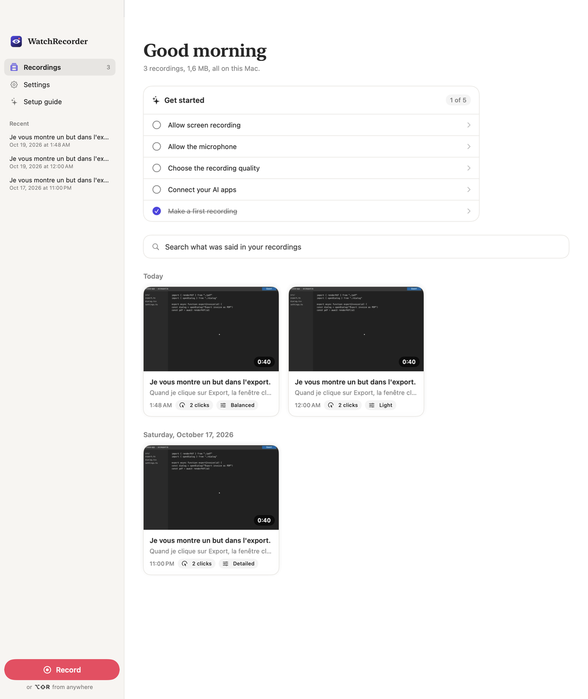
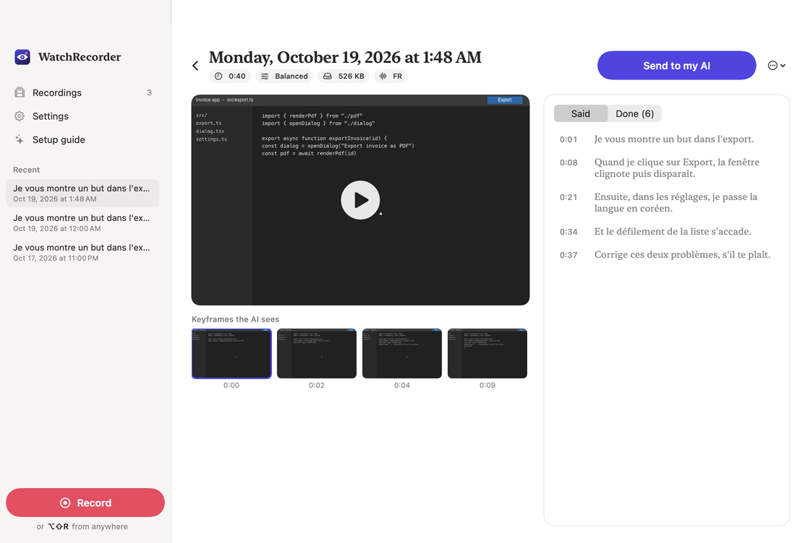
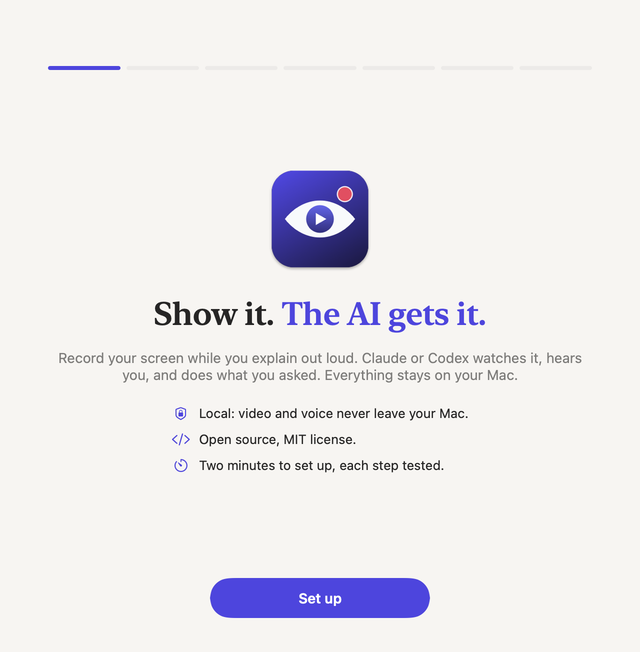
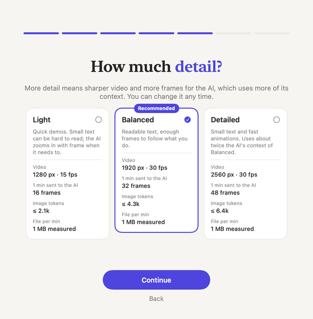
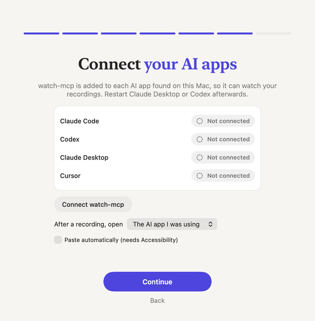

<p align="center"></p>

# watch-mcp

**Let Claude watch videos.** Drop an MP4/MOV/MKV/WebM path into Claude Code, Claude Desktop or Cursor, and Claude sees what happens on screen and hears what is said, without anyone touching ffmpeg.

**Install it by giving this repository to your AI.** In Claude Code, Codex or Cursor, say:

> Install https://github.com/Takinggg/watch-mcp

It follows [AGENTS.md](AGENTS.md): registers the server in every AI app on your machine, downloads the speech model, and on a Mac builds the WatchRecorder app. Or do it yourself in one line:

```bash
npx -y watch-mcp install
```

Then ask: *"Watch ~/Desktop/bug.mov and fix what I show you."*



## Why this exists (and the honest constraint)

Claude cannot ingest video. The Messages API takes images (JPEG, PNG, GIF, WebP) and PDFs; there is no video or audio content block. A request holds up to 600 images (100 on 200k-context models) and 32 MB, and once it carries more than 20 images a stricter per-image size limit applies (2000 px per side is safe) ([Anthropic vision docs](https://platform.claude.com/docs/en/build-with-claude/vision)).

So watch-mcp turns a video into the best possible *view* of it and hands that to Claude as normal MCP tool results (image + text blocks):

- **Keyframes picked where the picture changes.** A static stretch of a screen recording becomes one frame; a burst of activity gets many. Short events are kept, even a dialog that flashes for half a second.
- **Packed into labelled storyboards.** 16 keyframes per image, each tile captioned `#frame mm:ss.s` above the picture (nothing is covered). A several-minute video fits in a handful of images.
- **A timestamped transcript** of the speech, made locally with Whisper (Metal GPU on Apple Silicon), lined up with the keyframes in one timeline.
- **Drill-down tools** for when the overview is not enough: `zoom` for dense consecutive frames (motion, flicker, animation) and `frame` for one full-resolution still, with an optional crop to read small text.

Everything runs on your machine. No API key, no upload.

## Install

Requires Node.js 20 or later. ffmpeg comes bundled with the package (via [ffmpeg-static](https://www.npmjs.com/package/ffmpeg-static) and [@ffprobe-installer/ffprobe](https://www.npmjs.com/package/@ffprobe-installer/ffprobe)); the Whisper bindings come prebuilt ([@fugood/whisper.node](https://www.npmjs.com/package/@fugood/whisper.node)), so nothing compiles on install.

**Every AI app at once.** `npx -y watch-mcp install` finds Claude Code, Codex, Claude Desktop and Cursor on this machine and adds watch-mcp to each (idempotent; every edited file is backed up as `*.watch-mcp.bak`; `--dry-run` shows the plan, `--client codex` limits it, `npx -y watch-mcp uninstall` removes it). To do it by hand instead:

**Claude Code**

```bash
claude mcp add -s user watch -- npx -y watch-mcp
```

**Codex** (`~/.codex/config.toml`):

```toml
[mcp_servers.watch]
command = "npx"
args = ["-y", "watch-mcp"]
startup_timeout_sec = 60
```

**Claude Desktop** (`~/Library/Application Support/Claude/claude_desktop_config.json` on macOS, `%APPDATA%\Claude\claude_desktop_config.json` on Windows), then restart the app:

```json
{
  "mcpServers": {
    "watch": { "command": "npx", "args": ["-y", "watch-mcp"] }
  }
}
```

**Cursor** (`~/.cursor/mcp.json`, or `.cursor/mcp.json` in a project): same JSON as above.

**Speech models.** The first transcription downloads two files from Hugging Face into the cache folder: the Silero voice activity model (0.9 MB) and a Whisper model (574 MB on Apple Silicon, 148 MB elsewhere). Each download is checked against its published SHA-256. While it downloads, `watch_video` still returns the storyboards and says the transcript is pending; the `transcribe` tool then returns it without re-sending the images. To download ahead of time:

```bash
npx -y watch-mcp setup
```

`npx -y watch-mcp doctor` shows which ffmpeg, models and folders are in use.

## Tools

| Tool | What it returns | Parameters |
| --- | --- | --- |
| `watch_video` | Storyboard images of adaptively chosen keyframes, plus a timeline of what is seen, said (and done, for bundles). Use it first. | `path` (required), `budget` max keyframes (default about one per 3 s, rounded up to whole storyboards: 16 to 64; max 128), `start`/`end` to watch part of the video, `transcript` (default true), `language` (`"en"`, `"fr"`, `"ko"`...; default auto) |
| `zoom` | Up to 48 consecutive frames of a short segment, on storyboards with `mm:ss.ss` labels. For motion, flicker, animations. | `path`, `start`, `end` (required), `fps` (default: as dense as fits, up to the source rate), `crop` |
| `frame` | One still at full resolution (long edge up to 2000 px). For small on-screen text. | `path`, `t` (required), `crop`, `max_edge` |
| `transcribe` | The timestamped transcript only (text). Waits for the speech model if it is still downloading. | `path` (required), `language` |
| `latest_recording` | Same as `watch_video`, on the last recording made with the WatchRecorder app (below). Also exposed as the resource `watch://recordings/latest`. | `budget` |

`path` can be a video file or a `.watch` recording bundle (below). Times accept seconds (`83.5`) or timestamps (`01:23.5`, `1:02:03`).

watch-mcp also exposes an MCP prompt, `latest`. In Claude Code it is the command `/mcp__watch__latest`: it puts your latest WatchRecorder recording (path and what you said) into the current conversation, no copy and paste needed. `crop` is a region in fractions of the frame: `{"x": 0.5, "y": 0, "width": 0.5, "height": 0.5}` is the top-right quarter.

A `watch_video` result looks like this (text parts; the storyboard images sit between them):

```text
VIDEO demo-screen.mp4: 00:40.0, 1440x900, 30 fps, h264, audio aac.
15 keyframes (budget 16) on 1 storyboard image(s). Frames were picked where the picture changes ...
Storyboard 1/1: frames #1-#15 (00:00.0 to 00:39.0), read left to right, top to bottom.
[image]
Speech: 5 segment(s), language fr, transcribed locally with Whisper large-v3-turbo-q5_0.

TIMELINE (SEEN = keyframe, SAID = speech; in time order):
00:00.0  SEEN #1 (storyboard 1)  start
00:00.9  SAID 00:00.9-00:02.5: "Je vous montre un but dans l'export."
00:02.0  SEEN #2 (storyboard 1)  small change (<1% of the picture)
00:03.5  SEEN #3 (storyboard 1)  1% of the picture changed
00:08.5  SAID 00:08.5-00:12.0: "Quand je clique sur Export, la fenêtre clignote puis disparaît."
00:09.1  SEEN #4 (storyboard 1)  10% of the picture changed
...
00:09.5  SEEN #7 (storyboard 1)  10% of the picture changed; unchanged until 00:19.9
00:20.0  SEEN #8 (storyboard 1)  cut (new scene); unchanged until 00:23.9
```

On a [recording bundle](#recording-bundles-watch-an-open-format), the same timeline also says what was *done*, and each click is circled in yellow on the frame taken at that moment:

```text
00:08.5  SAID 00:08.5-00:12.0: "Quand je clique sur Export, la fenêtre clignote puis disparaît."
00:09.0  SEEN #4 (storyboard 1)  small change (<1% of the picture); click circled in yellow
00:09.0  DONE left click at x 93%, y 3% in invoice-app
00:09.1  SEEN #5 (storyboard 1)  10% of the picture changed
```

(The voice-over says "bug"; Whisper heard "but". Transcripts are good, not perfect.)

## How it works



- **Scan.** One decode pass at up to 8 samples per second (at most 2,400 samples, so long videos stay bounded), each frame shrunk to a 128 px grayscale signature.
- **Episodes.** Consecutive samples that keep changing (typing, a dialog flashing, a scroll) form an episode; pauses under about one second do not split it. Each episode contributes the frame that differs most from the picture just before it, so a flicker that reverts is still shown. If there are more episodes than budget, the strongest win.
- **Budget.** The remaining slots go to continuous change: walking the video, a frame is kept when it differs from the last kept frame by at least *N* pixels, and *N* is binary-searched so the total fits the budget. Static stretches cost nothing and are reported as "unchanged until ...".
- **Speech.** Silero VAD finds the speech; only those stretches (padded, joined with short silences) go to Whisper, and its timestamps are mapped back to the video. This keeps timestamps accurate after long silences and stops Whisper from inventing words over quiet parts. Whisper runs in a child process, so a native crash cannot take the MCP server down.
- **Cache.** Results are cached by a content fingerprint of the file (size plus 32 sampled chunks) and the parameters, so asking again, or moving the file, is instant.

### Image cost

A full storyboard is 1556x956 px for 16:9 video (1556x1052 for a 16:10 screen recording): 1,960 to 2,128 visual tokens by the API formula ⌈w/28⌉ × ⌈h/28⌉, so about 120 to 135 per keyframe. Models with the standard 1568-token image limit see it slightly downscaled. The default budget is at most 4 storyboards (up to about 8.5k image tokens); the maximum, 128 keyframes, is 8 storyboards (up to about 17k by the same formula), under Claude Code's default 25,000-token limit for MCP output. For a denser look at a long video, watch it in parts with `start`/`end`.

### Measured speed

On an Apple M5 Pro (macOS 26, Node 25, bundled ffmpeg 6.0), first call with an empty cache:

| Video | Result | Time |
| --- | --- | --- |
| 40 s screen recording, 1440x900, French voice-over ([demo/](scripts/make-demo-video.sh)) | 15 keyframes, 1 storyboard, 5 speech segments | 1.8 to 2.2 s |
| 2 min test pattern, 1920x1080, 30 fps, no speech | 46 keyframes, 3 storyboards | 2.4 s |
| Same call again (cache) | | 0.11 s |

Whisper large-v3-turbo (q5_0) transcribed 29.5 s of French and English speech in 1.0 s on the M5 Pro GPU, after a 0.5 s model load.

## How it differs from claude-video

[claude-video](https://github.com/bradautomates/claude-video) is a good agent *skill* with the same goal: it fetches a URL or local file, extracts scene-aware frames as separate images (up to 512 px wide), and gets a transcript from captions, local WhisperX or a cloud Whisper API. watch-mcp takes a different route:

- **An MCP server**, so it works in any MCP client: Claude Code, Claude Desktop chats, Cursor.
- **Storyboards instead of loose frames**: 64 keyframes travel as 4 images, far from the per-request image caps, with every tile labelled by frame number and time.
- **Drill-down** (`zoom`, `frame`, `crop`) instead of re-running the extraction.
- **Local by default**: bundled ffmpeg, Whisper on Metal with voice activity detection, no keys.
- What it does not do: download from URLs (claude-video does, with yt-dlp). Download the video first, then pass the path.

## WatchRecorder: show your AI instead of typing (macOS)

A native menu-bar app in [`companion/`](companion/), in English, French and Korean. Press **⌥⇧R**, show the problem while you explain it out loud, press **⌥⇧R** again. A floating pill shows that it is recording (live microphone level, timer, click to stop) and is left out of the video. Then WatchRecorder:

1. saves a [recording bundle](#recording-bundles-watch-an-open-format) in `~/Movies/WatchRecorder/`: the screen under the mouse pointer and your microphone in one video (same clock), plus what you did (clicks with their position, app switches, and, only if you already trust the app for Accessibility, how long and how much you typed, never which keys),
2. runs `watch-mcp finalize` on it: your words are transcribed with word timestamps and written into the bundle, and the storyboards are prepared, so the AI's first look is instant,
3. writes `~/Library/Application Support/watch-mcp/latest-recording.json` for the `latest_recording` tool,
4. copies a ready prompt and brings back the AI app you were using (Claude, ChatGPT/Codex, Cursor, VS Code or your terminal) on its current conversation: press ⌘V and send. No permission is needed for that. If you turn on *Paste Automatically*, it also presses ⌘V for you (this one needs Accessibility). The prompt:

```text
Watch my screen recording and do what I ask in it.

Recording: /Users/you/Movies/WatchRecorder/Recording 2026-10-19 at 01.02.03.watch (0:42)
What I said: "When I click Export the dialog flickers and closes. Fix it."

Use the watch-mcp tools (latest_recording, or watch_video with the path above) to see what I showed on screen.
```

**The library** (menu bar icon > *Open WatchRecorder*) lists every recording by day with the first thing you said, a search over everything said, and for each recording the video, the keyframes the AI will see, the transcript (click a line to jump there) and what you did. *Send to my AI* hands any past recording over again.

<p align="center">
  
  
</p>

**The setup guide** opens on first launch: one step per screen, each one tested for real (the microphone shows your voice, the shortcut has to be pressed, a first recording is made). It asks for each macOS permission only when you click, connects your AI apps with `watch-mcp install`, and lets you pick a quality preset with what it costs: image tokens per minute computed with Anthropic's image formula, and file size per minute measured on your own recordings.

<p align="center">
  
  
  
</p>

| Preset | Video | Keyframes for 1 min | Image tokens for 1 min (upper bound) |
| --- | --- | --- | --- |
| Light | 1280 px, 15 fps | 16 | 2,128 |
| Balanced (default) | 1920 px, 30 fps | 32 | 4,256 |
| Detailed | 2560 px, 30 fps | 48 | 6,384 |

The preset is stored in the bundle, so `watch_video` shows that many keyframes by default (one per 6, 3 or 1.5 seconds, capped at 32, 64 or 128).

**Build and run** (macOS 15 or later, Swift 6 from Xcode or the Command Line Tools):

```bash
cd companion && ./build-app.sh && open build/WatchRecorder.app
```

The icon sits in the menu bar (no Dock icon). It is red while recording; recordings stop by themselves after 10 minutes.

**Permissions.** macOS asks once for each:

- **Screen & System Audio Recording**: the first ⌥⇧R opens the system prompt. Turn WatchRecorder on in System Settings > Privacy & Security > Screen & System Audio Recording, then quit and reopen the app (macOS applies this permission at launch).
- **Microphone**: an Allow / Don't Allow dialog. Without it, WatchRecorder records the screen only.
- **Accessibility** (optional): only for *Paste Automatically*, which presses ⌘V for you. WatchRecorder asks for it only when you turn that option on, never by itself.

The global shortcut uses Carbon's `RegisterEventHotKey`, which needs no Accessibility permission. Clicks are observed with a global mouse monitor; per Apple's `NSEvent` documentation only key events need Accessibility trust, and WatchRecorder never asks for it (typing is simply left out when it is not granted). Double-clicking a `.watch` bundle in Finder opens its video. **Keeping permissions across rebuilds.** macOS ties these permissions to the app's code signature. `build-app.sh` signs ad-hoc by default, so every rebuild looks like a new app: the Screen Recording switch may stay on while applying to the old build (remove WatchRecorder with **−**, or run `tccutil reset ScreenCapture io.github.takinggg.watchrecorder`, then allow it again). This only concerns people who build the app themselves: a released app signed with a Developer ID keeps one identity across updates, so its users grant the permissions once. To sign every local build with the same identity, run `companion/make-signing-identity.sh` once (it makes a self-signed certificate in a keychain file inside `companion/.signing/`, not in your login keychain), then trust that certificate for code signing, which asks for your password: `security add-trusted-cert -r trustRoot -p codeSign -k "$PWD/companion/.signing/watchrecorder.keychain-db" companion/.signing/cert.pem` (from the repository root; `security` reads a relative keychain path as relative to `~/Library/Keychains`). From then on `build-app.sh` uses it (codesign only reads keychains on your search list, so the script lists the project keychain while signing and restores the list right after), and permissions survive rebuilds. `WATCHRECORDER_SIGN_IDENTITY="<name>"` uses any other signing certificate you have.

**What gets recorded:** the whole display under the mouse pointer, notifications and all, plus the microphone, clicks and app switches. Never which keys you press. System audio is not recorded. Files stay on your Mac.

**Settings** (`defaults write io.github.takinggg.watchrecorder <key> <value>`, then relaunch):

| Key | Default | |
| --- | --- | --- |
| `HotKey` | `opt+shift+r` | e.g. `ctrl+opt+r`; modifiers `ctrl`, `opt`, `shift`, `cmd` + a letter, digit or `space` |
| `MaxMinutes` | `10` | automatic stop |
| `RecordingsFolder` | `~/Movies/WatchRecorder` | |
| `RecordMicrophone` | `true` | also in the menu |
| `Quality` | `balanced` | `light`, `balanced` or `detailed`; also in Settings |
| `AppLanguage` | `auto` | `auto` (the Mac's language), `en`, `fr` or `ko`; also in Settings |
| `SendTo` | `auto` | `auto` (the AI app you were using: in front when you stop, else the last one you used), `claude`, `codex`, `off` (clipboard only), or an app's bundle id; also in the menu |
| `AutoPaste` | `false` | press ⌘V in that app for you (needs Accessibility); also in the menu |
| `WatchMcpCommand` | `npx -y watch-mcp` | how the app runs watch-mcp; when the app is built inside a watch-mcp checkout it uses that checkout's `dist/cli.js` |

**Sharing the app with other people** needs an Apple Developer Program membership (99 USD a year); this repository does not set that up. Without it, Gatekeeper blocks a downloaded copy. The steps are:

1. Sign with a *Developer ID Application* certificate and the hardened runtime, adding the `com.apple.security.device.audio-input` entitlement (the hardened runtime blocks the microphone without it): `codesign --force --options runtime --entitlements companion/WatchRecorder.entitlements --sign "Developer ID Application: <name> (<team id>)" WatchRecorder.app`.
2. Zip it and submit it to Apple's notary service: `xcrun notarytool submit WatchRecorder.zip --keychain-profile <profile> --wait`.
3. Staple the ticket so it also verifies offline: `xcrun stapler staple WatchRecorder.app`, then distribute the zip or a DMG.

## Recording bundles (`.watch`): an open format

A plain MP4 or MOV already keeps picture and sound on one clock. What it cannot hold is what you *did* and the word-by-word timing of what you *said*. A recording bundle adds that next to the video, so "0:12 click on Save, 'là ça plante', frame at 0:12" can be lined up exactly. WatchRecorder writes bundles; anything else (a future iOS app using a ReplayKit broadcast extension, a browser extension, a test harness) can produce the same format.

A bundle is a folder whose name ends in `.watch` (WatchRecorder registers it as a package, so Finder shows it as one file):

```text
Recording 2026-10-19 at 01.02.03.watch/
  manifest.json
  video.mov
  timeline.json
```

**manifest.json** (required)

```json
{
  "format": "watch-bundle",
  "version": 1,
  "video": "video.mov",
  "createdAt": "2026-10-19T01:02:03.000Z",
  "duration": 42.5,
  "recorder": { "name": "WatchRecorder", "version": "0.1.0" }
}
```

`format`, `version`, `video` (a path relative to the bundle, which must stay inside it) and `createdAt` are required; other fields are optional.

**timeline.json** (optional). Every time `t` is in seconds from the first frame of the video.

```json
{
  "version": 1,
  "events": [
    { "t": 0.0,  "type": "app", "name": "Safari" },
    { "t": 3.2,  "type": "typing", "duration": 2.4, "keys": 31, "app": "Safari" },
    { "t": 9.04, "type": "click", "button": "left", "x": 0.927, "y": 0.027, "app": "Safari" },
    { "t": 30.0, "type": "shortcut", "modifiers": ["cmd"], "app": "Safari" }
  ],
  "speech": {
    "source": "whisper-local:large-v3-turbo-q5_0",
    "language": "fr",
    "segments": [{ "start": 8.48, "end": 12.04, "text": "Quand je clique sur Export, la fenêtre clignote puis disparaît." }],
    "words": [{ "start": 8.48, "end": 8.71, "text": "Quand" }]
  },
  "keyframes": [{ "t": 9.04, "change": 0.002, "cut": false }]
}
```

| Event | Fields |
| --- | --- |
| `click` | `button` (`left`, `right`, `other`), `x`, `y`: position in the video frame as fractions from its top-left corner, `app` |
| `typing` | `duration`, `keys`: a burst of typing, counted, never its contents |
| `shortcut` | `modifiers` (`cmd`, `ctrl`, `opt`): the key itself is not recorded |
| `app` | `name`: the frontmost app changed |

- `events` is written by the recorder. Readers skip event types they do not know, and `watch-mcp finalize` keeps them, so the format can grow.
- `speech` and `keyframes` are filled in by `watch-mcp finalize <bundle>`. When a bundle already carries `speech`, watch-mcp uses it instead of transcribing again, so a producer can bring its own transcript (it must be on the video clock).
- `watch_video`, `zoom` and `latest_recording` accept a bundle path. Clicks become keyframes taken at the moment of the click (up to half the budget), circled in yellow, and every event appears as a `DONE` line in the timeline.

## Speech-to-text backends

Transcription goes through one small interface, [`TranscriptionBackend`](src/transcribers/backend.ts): say whether it is ready, prepare (download, check a key), and return segments plus word timings on the video clock. Local Whisper is the only backend today and the default. Others can be added in [`src/transcribers/`](src/transcribers/) and chosen with `WATCH_MCP_TRANSCRIBER`; results are cached per backend.

The one hard requirement is timestamps, since watch-mcp lines speech up with frames. Cloud APIs that return word timings could slot in this way (OpenAI's and Deepgram's speech-to-text APIs, for instance). [Wispr Flow](https://api-docs.wisprflow.ai/websocket_api) has a speech API too (WebSocket, 16 kHz mono PCM), but its keys come from Wispr's enterprise team rather than with the regular subscription, and its documentation does not mention word timestamps, so it is not integrated.

## Configuration

| Environment variable | Effect |
| --- | --- |
| `WATCH_MCP_WHISPER_MODEL` | `base` (148 MB), `small` (488 MB) or `large-v3-turbo-q5_0` (574 MB). Default: the turbo model on Apple Silicon, `base` elsewhere. |
| `WATCH_MCP_TRANSCRIBER` | Speech-to-text backend (default `whisper-local`, the only one today). |
| `WATCH_MCP_TRANSCRIBE=off` | Never transcribe. |
| `WATCH_MCP_WHISPER_GPU=0` | Run Whisper on the CPU. |
| `WATCH_MCP_HOME` | Data folder (default `~/Library/Caches/watch-mcp` on macOS, `~/.cache/watch-mcp` on Linux, `%LOCALAPPDATA%\watch-mcp` on Windows). |
| `WATCH_MCP_CACHE_DIR` | Cached results only (models stay in `WATCH_MCP_HOME`). |
| `WATCH_MCP_STATE_DIR` | Where `latest-recording.json` is read (default `~/Library/Application Support/watch-mcp` on macOS). |
| `WATCH_MCP_FFMPEG`, `WATCH_MCP_FFPROBE` | Use your own binaries (ffmpeg 5.1 or later). |

## Privacy

Videos never leave your machine. The only network access is the one-time model download from huggingface.co. There is no telemetry. Cached storyboards and transcripts live in the data folder above; delete it whenever you like.

## Limitations

- Tested on macOS 26 with Apple Silicon only, through Claude Code. Linux, Windows and Intel Macs should work (all dependencies ship builds for them) but have not been tried yet; neither have Claude Desktop and Cursor (their configuration above follows their documentation).
- Sounds other than speech (music, clicks, alerts) are not described.
- A change that lasts less than the gap between two analysis samples (1/8 s on videos up to 5 minutes, more on longer ones) can be missed by `watch_video`; `zoom` can look at every frame of a short segment.
- Cursor-only movement is usually too small to count as a change.
- Word timestamps come from Whisper's token timings: good enough to line words up with frames, not exact to the frame (some words share a timestamp). The accuracy of recorded event times against the video has not been measured yet; they are aligned on the timestamp of the first captured frame.
- Only local files: mp4, mov, mkv and webm are tested; avi, mpeg-ts and flv are accepted.

## Development

```bash
npm install
npm test          # 56 tests: unit, ffmpeg pipeline, bundles, MCP over stdio, transcription (macOS)
npm run build
node dist/cli.js watch some-video.mp4 --out ./watch-output   # storyboards + timeline.txt
scripts/make-demo-video.sh && scripts/make-demo-gif.sh        # the demo above (macOS)
node scripts/make-demo-bundle.mjs && node dist/cli.js finalize demo/demo-screen.watch   # demo bundle (synthetic events)
swift companion/Scripts/make-icon.swift "$PWD"                 # redraws the logo and the app icon
cd companion && swift test                                     # WatchRecorder: 13 tests (shortcut, prompt, bundle files, events, delivery)
```

`WatchRecorder --render-ui <out dir> <recordings folder> [--language en|fr|ko]` draws every screen (setup guide, library, recording, settings; light and dark) to PNG files without recording anything; the screenshots above come from it, on the synthetic demo. `WatchRecorder --handoff-test <bundle.watch>` runs everything that follows a recording (finalize, state file, prompt) on an existing bundle and prints the prompt instead of copying it. `WatchRecorder --self-test <seconds> <out.mov>` records only a test window drawn by the app itself (needs the Screen Recording permission).

The test videos are generated with ffmpeg (test patterns, plus a sentence spoken by macOS `say` for the transcription test).

## License

MIT, © 2026 Maxence Foulon.
